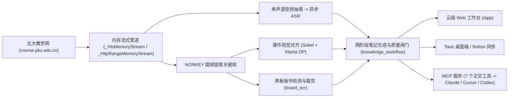
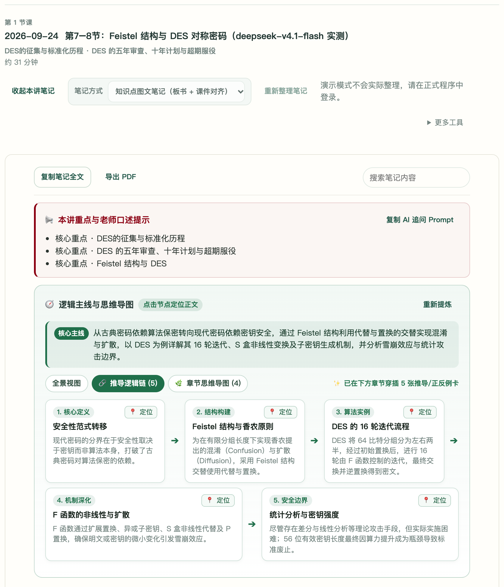
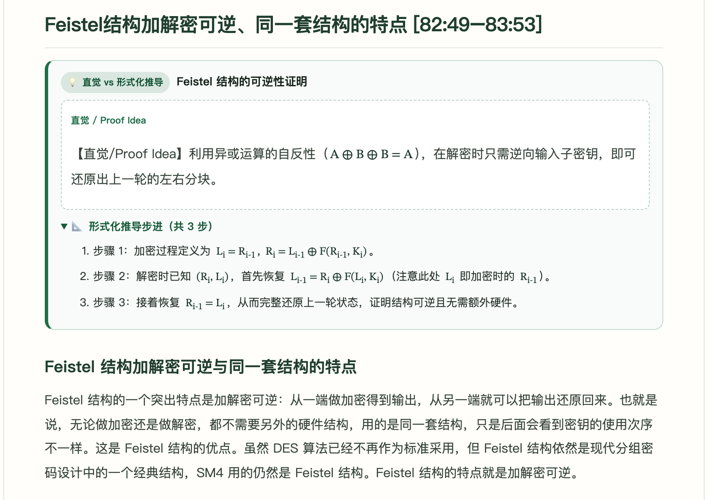

# PKU All in One：把北大教学网的课程，整理进你自己的 AI 助手

上半年我写过一个为算法课助教批改作业的小工具 [PKU AI 助教](/posts/pku-ai-ta)，把从教学网抓提交、视觉模型打分到写回成绩的链条跑通了。这学期换到学生视角复习和跟课时，面对的是另一套更碎片化的日常：

- 100 多页的高清 PDF 课件在教学网，课堂回放是 1–2 GB 起步的双流/HLS 视频，黑板手写推导散落在录像各处；
- 老师口头强调的考试重点、DDL 调整和评分细则夹杂在长达两小时的口述里；
- 市面上的通用 AI 笔记工具往往要求先把几 GB 视频想办法录屏或下载到本地、再手动上传到某个网页，最后把整门课的笔记锁死在封闭网页里，既接不进平时写代码和学习用的 AI 助手，也很难核对每句话到底对应哪页课件。

于是我基于此前对北大教学网和 IAAA 认证的工程积累，做了 **PKU All in One**（项目名 `pku-course-sync`），目前已部署上线在 [https://pku.aeoluswu.info](https://pku.aeoluswu.info)（免注册即可预览《信息安全引论》《计算概论》等真实示例课程：[https://pku.aeoluswu.info/app](https://pku.aeoluswu.info/app)）。

设计这个项目时，我一开始就定了一条边界：**PKU All in One 只负责连接教学网、清洗出可核验的课程上下文；真正的学习与提问，应该发生在你自己的 AI 助手和个人工作空间里。**

本文记录这个系统落地的几个核心工程模块与踩坑过程。

---

## 一、整体架构：云端免下载 + 本地工作台 + MCP

从数据流上看，系统要把「重介质的教学网视频与多格式附件」压缩成「轻量化、可追溯的文本与结构化知识」：



为了兼顾不同使用习惯，工程上拆成两种形态共用同一套核心管线（`pku_sync`）：

- **云端免下载工作台（`cloud_workspace`）**：打开网页即可绑定课程并同步课件、作业 DDL、通知与回放目录；服务端通过 `enforce_zero_local_download` 在接口和配置层双重锁定，绝不落盘原始视频或音频文件。
- **本地工作台与桌面端（Tauri / Rust + Python）**：适合希望将笔记、错题本、Markdown 讲义长期保存在本地或双向同步到个人 Notion 的同学。
- **标准 MCP 接入层（`mcp_server` / Streamable HTTP）**：把整学期的课件、笔记、板书推导、口述考点和作业提交封装成标准 MCP 工具，直接接入 Claude Desktop、Cursor、Codex 等客户端。

---

## 二、零落盘流式处理：在内存里边拉流边拆轨与抽帧

一节两小时的课堂录像往往在 1–2 GB 以上。如果在服务器端为每个任务先完整下载 `.mp4` 或拼接几百个 `.ts` 分片落盘，再调用 `ffmpeg` 转码，磁盘 IO、存储空间和清理竞态都会很快成为瓶颈。

在 `pku_sync/media.py` 中，我针对教学网常见的两种流媒体格式分别实现了纯内存的 file-like 流包装器，直接喂给 PyAV（`av.open(stream)`）在单次遍历中完成音频重采样切片与视频抽帧：

- **`_HlsMemoryStream`（AES 加密分片流）**：内部维护一个基于 `ThreadPoolExecutor` 的有界预取滑动窗口（窗口大小 `max(workers * 2, 4)`），并发拉取并解密 `.ts` 分片到内存缓冲区。`read()` 按需顺序吐出字节，一旦当前分片消费完毕，立即将 `self._current_buf` 置空释放内存，不会把整节课的视频留在 RAM 里。
- **`_HttpRangeMemoryStream`（支持 Range 的 MP4 流）**：面向可直接 Seek 的 MP4 容器，内部是一个 `4 MiB` 块粒度的内存 LRU 缓存（上限 `8` 块，即最多常驻 `32 MiB` 内存），并在服务端不支持 `HTTP Range` 且文件超过 `64 MiB` 时直接拒绝无界缓冲，防止 OOM。
- **单次解码抽轨与 `NONKEY` 跳帧**：在 `_decode_stream_audio_and_keyframes` 中，同一条流打开后同时挂载音频与视频流。面对超过 60 秒的长录像，直接设置 `video_stream.codec_context.skip_frame = "NONKEY"`，解码器只解码关键帧送入帧差检测，省掉绝大多数非关键帧的解码 CPU 开销；音频则通过 `_MemoryAudioChunkEncoder` 直接在内存中切分成单声道分段提交异步语音识别。

对于提交异步 ASR 所需的短暂对象存储访问，临时音频以 30 分钟短效私有签名提交转写，并在 `finally` 逻辑中清理临时音频对象，云端不长期保存原始音视频。

同时，高校课堂有一个天然的结构特点：一门《计算机网络》或《计算概论》往往有几十上百名同学同时选修。我们在 `cloud_workspace.py` 中设计了 `SharedLectureCache`——以 `sha256(course_id :: recording_signature)` 为索引键，在严格校验请求学生确实已选修同一门 `course_id` 的前提下，同课同学可以直接复用脱敏后的基础声轨转写与清洗后关键帧底座，省去冷启动中最昂贵的重复语音识别开销。

---

## 三、用 Sobel 边缘 + Viterbi DP 对齐课件页码，而不是让文本瞎猜

在做讲义整理时，最容易踩的一个坑是：**靠文本相似度（RAG / BM25）把转写段落匹配到 PPT 页码。**

实际试过就会发现非常不可靠：老师讲课时很少逐字照念幻灯片，而且同一份 100 页的课件里，核心术语会在几十页里反复出现。靠词频排出来的页码经常看似相关、实则张冠李戴——学生点开笔记里的页码引用，发现根本不是当时屏幕在放的那一页。

既然关键帧里本来就拍到了投影画面，这件事完全可以用确定性的视觉匹配来解决。在 `pku_sync/slide_alignment.py` 中，我采用了一套轻量的「边缘签名 + 保守门限 + Viterbi 动态规划」对齐方案：

1. **为什么选 Sobel 边缘而不是灰度直方图或感知哈希？**
   教室投影仪的拍摄画面往往伴随严重的过曝、偏色、低对比度以及 JPEG 压缩伪影，直接比灰度像素会误判。但幻灯片的标题层级、公式排版与框图几何边缘在这些干扰下非常稳定。
2. **渲染降采样 anti-aliasing**：
   先用 `pypdfium2` 以 `0.5x` 比例渲染 PDF 每一页，再用 `cv2.INTER_AREA` 缩放到 `256 × 144` 并计算 Sobel 梯度幅值，最后做零均值、单位方差归一化得到边缘签名向量 `_signature`（注意不能直接把 PDF 渲染成 `256 × 144`，否则细小字体会严重混叠成噪声）。
3. **宁缺毋滥的保守门槛 + Viterbi 时序约束**：
   帧签名与页签名点积后即可一次算出全矩阵相关距离 `1.0 - normalized_correlation`。我们刻意设置 `_ACCEPT_DISTANCE = 0.55`：只有本身足够像某一页课件的帧才进入序列规划，拍到老师走动、桌面窗口或模糊过渡帧时直接留空（`None`），**一个不确定的空白比一个自信满满的错误页码好得多**。

核心对齐与状态转移逻辑很简洁：

```python
_ACCEPT_DISTANCE = 0.55
_FORWARD_COST = 0.004   # 正常向后翻页代价极低
_BACKWARD_COST = 0.02   # 偶尔回翻前一页也有合理代价
_DECK_SWITCH_COST = 0.15  # 跨 PDF 文件切换代价

cost = 1.0 - (frames @ pages.T) / frames.shape[1]
best = cost.min(axis=1)
confident = np.flatnonzero(best <= _ACCEPT_DISTANCE)

assigned = [None] * frames.shape[0]
if confident.size:
    chosen = _viterbi(cost[confident], deck_ids)
    for frame_idx, page_idx in zip(confident, chosen):
        if cost[frame_idx, page_idx] <= _ACCEPT_DISTANCE:
            assigned[int(frame_idx)] = int(page_idx)
        else:
            assigned[int(frame_idx)] = int(np.argmin(cost[frame_idx]))
```

这里还有一个纯粹的跨平台工程坑：部署桌面端到 Windows 同学机器上时，中文课程目录名会导致 OpenCV 的 `cv2.imread` 静默返回 `None`（底层窄字符路径编码问题）。最后在 `_read_gray` 里统一改成 `np.fromfile` 读裸字节再 `cv2.imdecode` 解码，彻底绕过了这个问题。

---

## 四、识别真实的教室黑板：多流布局解析与板书还原

课件对齐解决了「投影了哪一页」，但理工科核心课的灵魂往往在黑板推演上。`pku_sync/board_ocr.py` 负责从杂乱的录像关键帧里把真正有手写板书的画面筛出来。

实际教室录像的构图远比想象中混乱，`_analyze_board_bgr` 必须先处理各种布局与废片：

- **多种教室机位与画中画**：既有黑板特写镜头，也有左下为主画面、右上角带 L 形画中画（PiP）的双流画面；程序通过检测局部区域的方差和水平/垂直拼接缝梯度（`h_seam`、`v_seam`）判断是否为画中画，若是纯课件双流或黑屏闪烁的 `dead_canvas_pip`、均匀静态占位图 `placeholder`，直接过滤掉。
- **黑板/灰板/哑光白板自适应定位**：先对画面做大核中值滤波估算背景色，结合通道差值定位绿板或深灰板面（以及无黑板墙场景下的哑光白板），再把强反光斑块、讲台上走动的暖肤色人脸与深阴影从有效区域中抠除并做形态学腐蚀，防止人物衣服边缘被误判成粉笔字。
- **极性不对称的笔迹检测与连续区域裁剪**：黑板粉笔字表现为局部高通礼帽（Top-Hat）正向脉冲，而白板记号笔表现为黑帽（Black-Hat）负向脉冲；利用正负异常像素比例的不对称性划定 `6 × 12` 网格中真正写字的格子，并通过 `_crop_active_board_panel` 沿连续板面网格外扩裁剪——**遇到旁边紧挨着的投影仪白幕布就自动停下**，避免把无关投影一起裁进来。

筛选出的高信息量候选帧（每讲默认上限 `MAX_BOARD_OCR_FRAMES = 6`）会连同对应时间段的老师口述上下文一起交给视觉模型还原为标准 Markdown + LaTeX 推导。前端阅读器除了保留原图对照外，还支持一键「画质增强」和「反色白底」（CSS `invert(1) hue-rotate(180deg)`），夜间护眼阅读或导出打印都很方便。

---

## 五、可核验笔记生成与模型工程权衡

在生成笔记这一环，我刻意区分**「可追溯核验」**与**「空洞的零幻觉承诺」**：模型不可能永远不出错，但系统必须把每一步做成「有依据、能查原页、不强行编造」。

落地到 `knowledge_workflow.py` 里有三条硬约束：

1. **时间戳由程序计算，不让模型估算**：每个章节的 `source_span` 起止时间全部由程序根据源转写片段真实时间戳计算附加；
2. **两阶段宏观规划 + 并发精写**：初版笔记曾把一节半小时的课切出 31 个碎小节，调用了 32 次模型，前后重复小标题多。后来在 `PLAN_SYSTEM` 中改为按 `180–600` 秒的完整教学模块切分大单元（把同一算法的各步变换、轮函数各组件强制合并到同一单元里），再通过 `ThreadPoolExecutor` 并发精写并做 `.notes-parts` 断点缓存，同时将老师的口述考点、DDL 变更与签到码单独摘出；
3. **事实纠偏与质量闸门**：写作阶段把对应页码的课件正文作为对照上下文（仅用于核对已经提到的数字、术语和指代，禁止模型把课件里老师没讲的内容扩写成授课内容）；生成后由 `record_issues` 做结构与证据指纹校验，不达标则主动阻断并标出原片回看位置。

以 **2026-09-24《信息安全引论》Feistel 与 DES** 一讲（约 30 分钟、668 段转写 + 106 页课件）的实际测试为例：

- 切分与排版约束上线后，并把默认笔记模型切换为 `deepseek-v4.1-flash`（在服务端显式下发 `enable_thinking=False` 关闭思考链输出，避免思考 token 拉爆延迟与账单），单讲调用次数从 **32 次降到 9 次**（1 次全局规划 + 8 次并发分节，总耗时 **45.6s**），成本下降约 90%，重复小标题降为 0；
- 更关键的是**课件事实纠偏真正起了作用**：原语音转写把 DES S 盒误听成了「8 位输入」，系统对照课件第 57 页后主动纠正为「6 比特输入 → 4 比特输出（第 1、6 位选行，中间 4 位选列）」，同时保留了原始转写时间锚点 `[87:50–95:49]` 供随时回溯。

下面是真实阅读器在 `/app` 演示模式下的界面效果——顶部展示口述重点、可点击跳转正文的推导逻辑链（`logic_chain`），正文各章节下方自动穿插「直觉 vs 形式化推导」证明卡：





---

## 六、接入你自己的 AI 工作流：从 18 个工具收敛到 7 个正交 MCP 工具

笔记整理得再好，如果只能停留在某一个网页里看，价值还是有限。学生真正用得最多的是在写作业、写代码、备考复习时，让身边的 AI 助手（Claude Desktop、Cursor、Codex、Antigravity 等）直接翻看本学期所有课程资料。

最早我在本地原型里一口气暴露了 **18 个细粒度 MCP 工具**（读取总纲、读单讲、读导图、读板书、读小测、查作业、查在线测试、预检提交……分别对应独立函数）。实际跑起来很快发现问题：**工具数量一多，模型每次做路由都要反复犹豫该调哪个接口，参数也容易传错，上下文很快被工具 schema 塞满。**

后来在 `pku_sync/mcp_server.py` 里做了一次彻底收敛，把整个教学网能力压缩为 **7 个正交、职责边界清晰的工具**（同时支持本地 `stdio` 与云端 Streamable HTTP）：

- **`list_courses`**：列出已同步的课程、已整理/精炼讲次计数与作业概况；
- **`read_lecture`**：按需渐进读取讲次内容——先传 `lecture=""` 只拿轻量章节目录，确认目标后再读指定讲次的精炼讲义、口述考点、板书 OCR 与逻辑导图；
- **`search_course_knowledge`**：跨精炼讲义、笔记、总结、作业与课件做全文检索；
- **`read_course_material`**：读取课程总纲、材料索引，或按页码区间提取 PDF / ZIP / DOCX / PPTX / 文本课件内容；
- **`get_assignments_and_grades`**：查询已同步作业与 DDL，支持 `live_portal=True` 实时拉取教学网成绩与提交回执，或解析在线测试题目；
- **`submit_course_work`**：校验本地作业附件及命名规范、暂存或正式提交作业与在线测验；
- **`organize_course_content`**：触发单讲/批量回放转写整理、AI 精细笔记提炼（`refine_lecture`），或本地导出带水印复习 PDF / ZIP 包。

其中有两个在 Agent 工程中非常关键的约束：

1. **渐进式披露（Progressive Disclosure）**：在工具 `instructions` 里明确要求先调用 `read_lecture(course, lecture="")` 看目录，再按讲次提取正文，避免 Agent 一次把一学期的长讲义全塞爆上下文窗口。
2. **写操作的双步安全确认门控（`confirm_submit`）**：接入了作业提交能力后，最怕模型「自作主张替你交作业」。因此 `submit_course_work` 的 `confirm_submit` 默认值永远为 `False`——第一次调用只负责校验文件命名、压缩包结构、截止时间 warning，或对在线测验执行暂存草稿（`assessment.py`）；只有在向同学展示核对清单并得到**本人明确确认**后，才允许携带 `confirm_submit=True` 执行最终提交并核验教学网回执。

在云端多租户与凭据安全方面，系统为每位用户隔离独立工作目录（`0700` 权限），采用 `PBKDF2-HMAC-SHA256`（310,000 次迭代）+ `AES-256-GCM` 加密保存凭证，并在浏览器会话中结合服务端主密钥与 `HttpOnly` Cookie 密钥做分片派生（`derive_split_secret`），确保任何单侧都无法独立解密用户教学网凭证，同时提供一键物理擦除全部云端数据的接口。

---

## 七、结语

做完 PKU All in One 之后，我最大的体会是：**AI 应用的工程壁垒，通常不在那几百字的 Prompt 里，而在它周围那些枯燥但决定可靠性的细节里。**

包括怎么在不把服务器硬盘撑爆的前提下边拉加密 HLS 流边拆出音频和关键帧，怎么在投影过曝和 Windows 中文路径下把 PPT 页码老老实实对齐，怎么从画中画和粉笔灰里把黑板区域干净地抠出来，以及怎么把十几个零碎接口收敛成让 Agent 一眼就能用对、且绝不误交作业的 7 个正交工具。

如果你也在北大选课或想直接看看实际整理出来的讲义、板书和推导卡效果，可以访问线上工作台与免注册示例页：

- 主页：[https://pku.aeoluswu.info](https://pku.aeoluswu.info)
- 免注册示例课程预览：[https://pku.aeoluswu.info/app](https://pku.aeoluswu.info/app)
